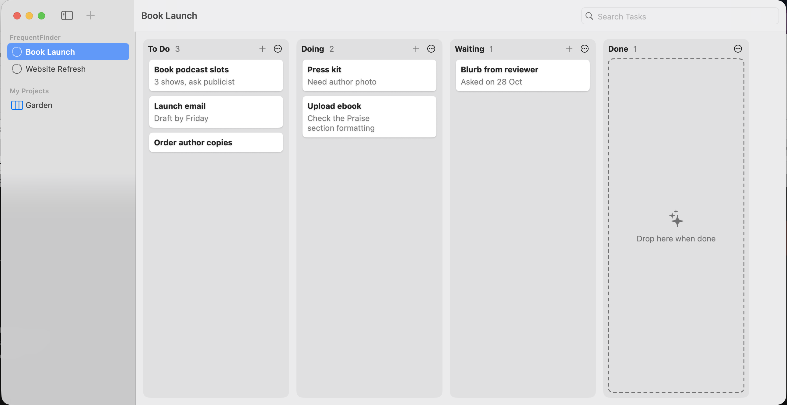

# OpenPMTools

A personal Kanban board for macOS. It shows your projects on the left and the selected project's board on the right.
Tasks move across columns; moving one into the last column (Done) archives it, so it can still be found and restored.
It is a companion to [FrequentFinder](../frequent-finder): FrequentFinder's active projects appear automatically
and follow its changes live, and projects that exist only in OpenPMTools ("My Projects") make it useful on its own.
Drag a project from My Projects onto FrequentFinder's All Projects window to make it a FrequentFinder project; its
board stays with it. The `pmt` command does everything the app does to boards and tasks.
The Big Board toolbar button opens a window with every open task from every project. Columns with the same name are
merged, and each card shows its project's name and colour. A card can only move to a column its own board has.
Linked Apps (Settings, ⌘,): drop an app from Finder or the Dock, or click Add App…. The toolbar and each sidebar row's
menu then have "Open in <app>". An app can be linked when it opens links of the form `<scheme>://project/<project id>`;
its scheme is read from the app. OpenPMTools opens `openpmtools://project/<project id>` itself, so FrequentFinder (and
`open` in Terminal) can link to a board.
Tasks can have a due date and a priority (Low, Medium, High), set in the task editor or with `pmt`. A near due date
raises the priority shown (due today or overdue: High; within 2 days: Medium) without changing what you set. A stripe
along the top of the card and a date label show how near it is: red (today or overdue), yellow (within 2 days), green;
the label also has a symbol and words ("Overdue · 12 Nov", "Today", "Tomorrow"), so colour is never the only signal.
Cards sort by priority, then due date, then your own order. Dropping a card onto another card gives it that card's
priority. ⌘N adds a task to the top of the shown project's first column (on the Big Board it asks which project);
⇧⌘N adds a project.



## Working with FrequentFinder

FrequentFinder's active projects show up in the sidebar under their own section, with their boards, and renames follow live.
To add one, drag a project from My Projects onto the sidebar of FrequentFinder's All Projects window; its board goes with it.
This needs FrequentFinder on its `main` branch (projects there have ids, which boards are matched by).

## Build and install

Needs macOS 15 or later, Xcode (or the Swift toolchain), and the FrequentFinder repo checked out next to this one
(`../frequent-finder`).

```bash
scripts/make-app.sh            # builds build/OpenPMTools.app and installs ~/.local/bin/pmt
scripts/make-app.sh --install  # also copies the app to /Applications
```

Make sure `~/.local/bin` is on your `PATH`.

## Daily backup

This script backs up both apps' data (`~/.config/frequent-finder`, `~/.config/openpmtools`) and their app preferences
into one dated file, `pmtools-YYYY-MM-DD.tar.gz`, in a Dropbox folder. It deletes the backup from 30 days ago, but only
once today's backup is written, so the newest backup always stays. If any step fails, it shows a macOS notification
and the error goes to `/tmp/pmtools-backup.err`.

Save it as `~/bin/pmtools-backup` and run `chmod +x ~/bin/pmtools-backup`:

```bash
#!/bin/bash
# Daily backup of FrequentFinder and OpenPMTools data and app preferences. Keeps 30 days.
set -euo pipefail
trap 'osascript -e "display notification \"Line $LINENO failed. See /tmp/pmtools-backup.err\" with title \"PMTools backup failed\" sound name \"Basso\""' ERR
dest="$HOME/Library/CloudStorage/Dropbox/PMTools-backups"
backup="$dest/pmtools-$(date +%Y-%m-%d).tar.gz"
tmp=$(mktemp -d)
trap 'rm -rf "$tmp"' EXIT
mkdir -p "$dest" "$tmp/preferences"
cp -R "$HOME/.config/frequent-finder" "$HOME/.config/openpmtools" "$tmp/"
for id in org.hyland-wood.FrequentFinder org.hyland-wood.OpenPMTools; do
    defaults export "$id" "$tmp/preferences/$id.plist"
done
tar -czf "$backup" -C "$tmp" .
# Delete the 30-day-old backup only when today's is there, so the newest backup always stays.
# By name, not by listing: under launchd, macOS privacy rules block listing Dropbox folders.
# ponytail: a day the Mac misses leaves one old file behind; delete it by hand.
if [ -s "$backup" ]; then rm -f "$dest/pmtools-$(date -v-30d +%Y-%m-%d).tar.gz"; fi
```

To run it every day at 12:00, save this as `~/Library/LaunchAgents/org.hyland-wood.pmtools-backup.plist`, with your
own home folder in the path:

```xml
<?xml version="1.0" encoding="UTF-8"?>
<!DOCTYPE plist PUBLIC "-//Apple//DTD PLIST 1.0//EN" "http://www.apple.com/DTDs/PropertyList-1.0.dtd">
<plist version="1.0">
<dict>
    <key>Label</key>
    <string>org.hyland-wood.pmtools-backup</string>
    <key>ProgramArguments</key>
    <array>
        <string>/Users/YOU/bin/pmtools-backup</string>
    </array>
    <key>StartCalendarInterval</key>
    <dict>
        <key>Hour</key>
        <integer>12</integer>
        <key>Minute</key>
        <integer>0</integer>
    </dict>
    <key>StandardErrorPath</key>
    <string>/tmp/pmtools-backup.err</string>
</dict>
</plist>
```

Then load it, and run it once to test:

```bash
launchctl bootstrap gui/$(id -u) ~/Library/LaunchAgents/org.hyland-wood.pmtools-backup.plist
launchctl kickstart gui/$(id -u)/org.hyland-wood.pmtools-backup
```

If the Mac is asleep at 12:00, the backup runs when it wakes. macOS lets only the program that made a file in Dropbox
change or delete it. So if you move the script, it cannot delete the old script's backups: delete those by hand.
To get preferences back, quit the app and run `defaults import <bundle id> <file>.plist`.

## Command line

```
$ pmt help
Usage:
  pmt projects [--json]
  pmt project add <name>
  pmt project remove <name> [--force]
  pmt project rename <name> <new>
  pmt board <project> [--json]
  pmt board create <project> <column> <column>...   (the last column is Done)
  pmt board delete <project> [--force]
  pmt board list [--json]
  pmt board attach <project-id> <project-name>
  pmt column add <project> <name> [--at N]
  pmt column rename <project> <name> <new>
  pmt column move <project> <name> <N>
  pmt column remove <project> <name>
  pmt task add <project> <title> [--notes "..."] [--column <name>] [--due YYYY-MM-DD] [--priority low|medium|high]
  pmt task edit <id> [--title "..."] [--notes "..."] [--due YYYY-MM-DD|none] [--priority low|medium|high|none]
  pmt task move <id> <column>
  pmt task done <id>
  pmt task delete <id>
  pmt task restore <id>
  pmt task show <id>
  pmt search <text> [--done] [--json]
  pmt help
Positions (--at, column move) count from 1.
Data file: ~/.config/openpmtools/boards.json (override with PMT_CONFIG)
```

## Data file

`~/.config/openpmtools/boards.json` (set `PMT_CONFIG` to use another file) holds your own projects and every
board. Boards are matched to projects by id, so renaming a project keeps its board. FrequentFinder's
`~/.config/frequent-finder/projects.json` (or `FF_CONFIG`) is read for its projects. The app reloads both when
they change.

## Development

```bash
swift test
swift scripts/make-icon.swift   # redraws Resources/AppIcon.icns
```
